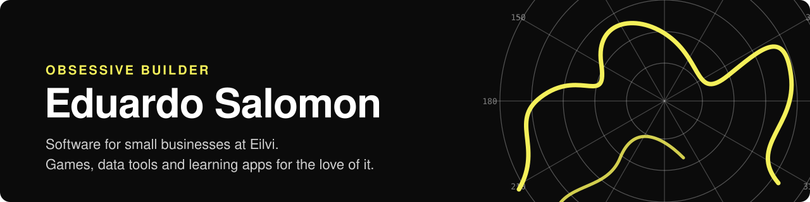
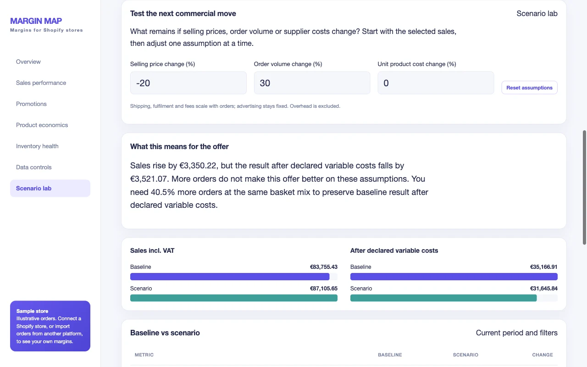
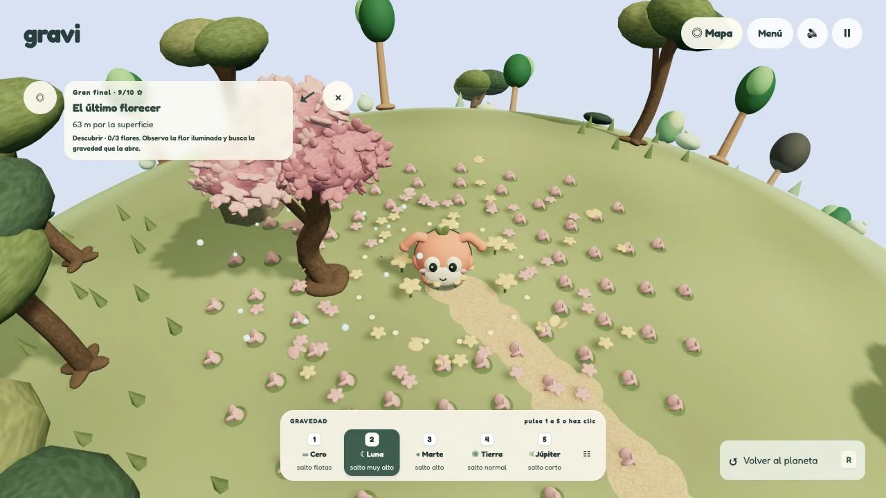
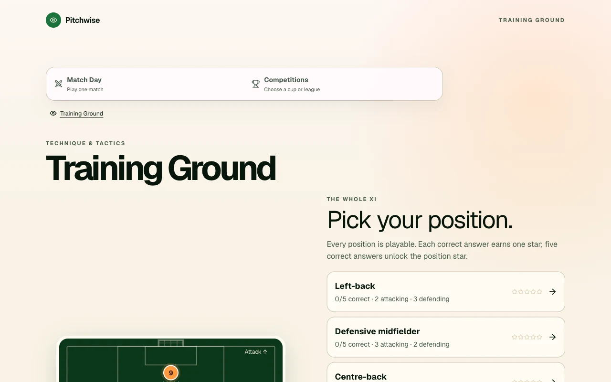

**Obsessive builder.** I make software for small businesses at [Eilvi](https://eilvi.com/) — and, the rest of the time, whatever idea won't leave me alone: games, data tools, learning apps, and tools for my own family.

[Portfolio](https://eduardosalomon.eilvi.com/) · [Eilvi](https://eilvi.com/) · [LinkedIn](https://www.linkedin.com/in/eduardo-salomon) · [Get in touch](https://eduardosalomon.eilvi.com/contact)

I came to software from **sales, marketing, and business development**, so I start with people, not code: who needs this, how does their work actually happen, and what would make the next step easier? At **[Eilvi](https://eilvi.com/)**, my consulting, AI, and automation studio, that turns into working software — from data models and validation to interfaces and integrations.

Outside client work, I build to learn: football, chess, family routines, and small playable worlds.

<table>
  <tr>
    <td width="33%"> <strong>Margin Map</strong> Business software</td>
    <td width="33%"> <strong>Gravi</strong> 3D exploration</td>
    <td width="33%"> <strong>Pitchwise</strong> Football tactics & play</td>
  </tr>
</table>

## Build log

What I pushed most recently, updated daily by a GitHub Action.

<!-- build-log:start -->
| When | Project | Latest commit |
| --- | --- | --- |
| yesterday | [tu-inflacion-no-es-el-ipc](https://github.com/eduardosalomonm/tu-inflacion-no-es-el-ipc) | Hacerla compartible: apuesta, máquina del tiempo, imagen para redes y p… |
| 6 days ago | [margin-map](https://github.com/eduardosalomonm/margin-map) | Release 1.3.0: traceable promotion decisions and safe workbook imports |
| 1 week ago | [pomodoro-musculo](https://github.com/eduardosalomonm/pomodoro-musculo) | Beta 0.9.0: validación del conteo, avisos por calendario y logros |
| 1 week ago | [gravi](https://github.com/eduardosalomonm/gravi) | Publish clean gravi source edition |
| 1 week ago | [pitchwise-game](https://github.com/eduardosalomonm/pitchwise-game) | Publish clean pitchwise source edition |
<!-- build-log:end -->

## Business software

### [Margin Map](https://github.com/eduardosalomonm/margin-map)
Would more sales leave less margin? A decision tool for comparing e-commerce promotions, built from my need to understand the numbers in my own business.

**Engineering focus:** effective-dated product and bundle costs, explicit missing inputs, tested scenario calculations, and reproducible HTML/PDF reporting from Shopify snapshots or Excel. The public walkthrough compares two hypothetical offers with synthetic data; it does not claim a measured business uplift or a real-store Shopify pilot.

`Python` `Excel` `Shopify`

[Try the decision](https://marginmap.eilvi.com/#decision-case) · [Public code](https://github.com/eduardosalomonm/margin-map) · [Case study](https://eduardosalomon.eilvi.com/projects/a1-unit-economics)

### [Inbox Desk](https://github.com/eduardosalomonm/inbox-desk)
Shared-inbox triage that classifies messages, creates tickets, and prepares Gmail drafts for human review.

**Engineering focus:** explicit decision rules, durable processing records, retry handling, and an authenticated review dashboard. A credential-free local demo uses fictional messages.

`Node.js` `JavaScript` `n8n` `Gmail`

[Public code & local demo](https://github.com/eduardosalomonm/inbox-desk) · [Case study & video](https://eduardosalomon.eilvi.com/projects/inbox-desk)

### [CercaVet](https://github.com/eduardosalomonm/cercavet)
A configurable workspace connecting veterinary appointments, consultation notes, follow-ups, and return visits.

**Engineering focus:** linked records, workflow transitions, and configurable clinic identity. The public demo uses fictional patients and browser-local storage.

`TypeScript` `Vite`

[Live demo](https://veterinaria.eilvi.com/) · [Public code](https://github.com/eduardosalomonm/cercavet)

## Things I build for fun

### [Gravi](https://eduardosalomon.eilvi.com/projects/gravi)
A small browser-based 3D world where changing gravity opens new ways to move, explore, and solve challenges.

**Engineering focus:** movement and gravity controls, exploration-driven challenges, touch and keyboard input, and locally saved progress.

`React` `TypeScript` `Three.js`

[Play Gravi](https://gravi.eduardosalomonm.chatgpt.site/) · [Public code](https://github.com/eduardosalomonm/gravi) · [Case study](https://eduardosalomon.eilvi.com/projects/gravi)

### [Pitchwise](https://eduardosalomon.eilvi.com/projects/the-invisible-game)
Football tactics through playable scenarios, guided explanations, and competitions. A personal project combining my interest in football with interactive learning.

**Engineering focus:** tactical decision scenarios, match and competition flows, progress tracking, and responsive interaction.

`React` `TypeScript`

[Play Pitchwise](https://pitchwise.eilvi.com/) · [Public code](https://github.com/eduardosalomonm/pitchwise-game) · [Case study](https://eduardosalomon.eilvi.com/projects/the-invisible-game)

## More side projects

| Project | What I explore |
| --- | --- |
| [Premier Money](https://eduardosalomon.eilvi.com/projects/premier-money) | Football finances and results through interactive SVG charts, season comparisons, and explicit data sources. |
| [Elu](https://eduardosalomon.eilvi.com/projects/elu) | Family routines and shared records: React, TypeScript, offline queues, and a public demo separated from private family data. |
| [Pomodoro Músculo](https://github.com/eduardosalomonm/pomodoro-musculo) | Focus and active breaks, with optional on-device movement tracking. JavaScript, MediaPipe, and PWA features. |
| [FolioShift](https://github.com/eduardosalomonm/market-radar) | Portfolio and market-data exploration with Python and Streamlit, saved analysis, and transparent scoring. |

**[Explore the full showcase →](https://github.com/eduardosalomonm/eduardosalomonm/blob/main/SHOWCASE.md)** — more apps, games, data tools, and interactive essays, including projects with public demos and private source code.

## How I build

- Start with the workflow and the decision the user needs to make.
- Keep business rules explicit and important outputs traceable.
- Validate inputs and test the logic that carries the most risk.
- Use AI where it helps, with clear boundaries around data and human review.
- Make work easy to evaluate through demos, sample data, and documented limitations.

**Core tools:** Python, TypeScript, JavaScript, React, Node.js, SQL, and n8n. Individual projects also use FastAPI, Streamlit, Three.js, and React Native.

For broader product work and implementation details, visit my **[portfolio](https://eduardosalomon.eilvi.com/projects)**.
